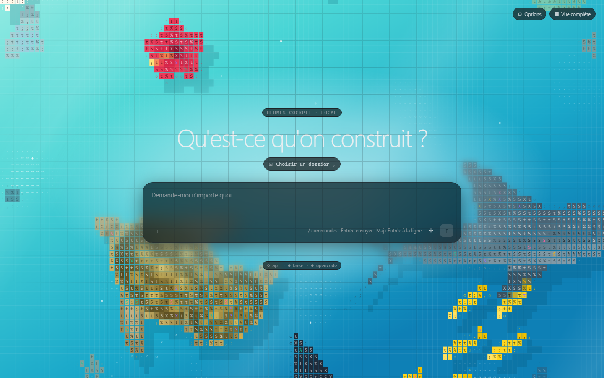
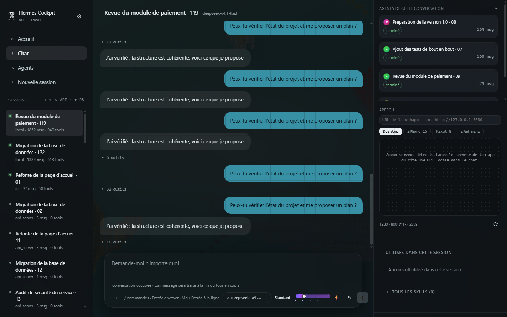

# Hermes Cockpit

Cockpit **local** pour piloter et observer des agents [Hermes](https://hermes-agent.nousresearch.com) :
sessions, sous-agents, agents OpenCode, chat complet, aperçu web du projet en cours et
dictée vocale hors ligne.

Application desktop (Tauri 2 + React 18) et service Rust (axum) qui lit la base d'état
Hermes **en lecture seule** et relaie les tours vers l'API Hermes ou vers le CLI.



## Ce que fait l'application

- **Sessions** : liste des conversations avec origine (`local`, `api_server`, `cli`,
  OpenCode), état en cours, nombre de messages et d'outils.
- **Sous-agents** : les sessions enfants apparaissent **sous leur conversation parente**,
  avec un avatar déterministe, un anneau pulsé pendant qu'ils tournent et une croix pour
  les masquer — ils disparaissent aussi seuls 10 min après leur fin. Un bouton retour
  ramène à la conversation principale.
- **Chat** : bulles façon messagerie (vous à droite, l'agent à gauche), blocs d'activité
  repliés (outils + thinking), file d'attente quand un tour est déjà en cours, collage
  d'images, menu `/` (commandes + skills), sélecteur de modèle, barre d'effort animée.
- **Dictée vocale locale** : enregistrement WAV 16 kHz dans la page, transcription par
  sherpa-onnx + modèle Parakeet — **aucune clé d'API, aucun envoi sur Internet**.
- **Aperçu web** : charge le serveur de développement **du projet dont parle la
  conversation** (jamais celui d'un autre projet), dans un cadre Desktop, iPhone 15,
  Pixel 8 ou iPad mini.
- **Ultracode** : trois agents en parallèle sur la même tâche (implémentation, revue,
  vérification), animation plein écran et pastilles d'état en direct.
- **Panneaux redimensionnables** : barre latérale et aperçu se glissent à la souris, la
  largeur est mémorisée.




## Architecture

```
┌───────────────────────────┐        ┌──────────────────────────────┐
│ Application desktop       │  HTTP  │ Service local (Rust, axum)   │
│ Tauri 2 + React 18        │ ─────► │ 127.0.0.1:8791               │
│ (même bundle que le web)  │  SSE   │                              │
└───────────────────────────┘        │  • state.db  (lecture seule) │
                                     │  • API Hermes (proxy SSE)    │
                                     │  • CLI Hermes (sessions CLI) │
                                     │  • dictée (sherpa-onnx)      │
                                     └──────────────────────────────┘
```

Trois invariants :

1. **Aucun secret dans le dépôt.** La clé d'API Hermes est lue au runtime par le service
   et ne quitte jamais la machine ; le front n'appelle que `127.0.0.1:8791`.
2. **Aucune écriture dans `state.db`.** La base est ouverte en `read_only(true)`, et un
   test Rust vérifie que toute écriture échoue.
3. **Aucune donnée simulée.** Si une source manque, l'écran le dit au lieu d'inventer.

Détails : [`docs/architecture.md`](docs/architecture.md).

## Installation

Prérequis : Windows 10/11, macOS 12+ ou Linux ; [Node 20+](https://nodejs.org),
[pnpm](https://pnpm.io), [Rust stable](https://rustup.rs), et une installation Hermes
(`~/.hermes` ou `HERMES_HOME`).

```bash
git clone https://github.com/JFoissac/hermes-cockpit.git
cd hermes-cockpit

# 1. le service local (obligatoire — sans lui, l'app n'a aucune donnée)
cargo run --release --manifest-path server/Cargo.toml

# 2. l'application desktop, dans un autre terminal
cd web && pnpm install && pnpm tauri dev
```

Pour l'utiliser dans un navigateur : `pnpm -C web dev` puis <http://127.0.0.1:5183>
(Vite relaie `/api` vers le service).

Guide complet, variables d'environnement et build des installeurs :
[`docs/installation.md`](docs/installation.md).

## Utilisation

Envoyer un message, dicter, changer de modèle, lancer Ultracode, redimensionner les
panneaux : [`docs/usage.md`](docs/usage.md).

## API du service

| Méthode | Route | Rôle |
|---|---|---|
| GET | `/api/health` | état de l'API Hermes, de la base et d'OpenCode |
| GET | `/api/observatory/sessions?limit=60` | sessions (origine, état, compteurs) |
| GET | `/api/observatory/sessions/{id}/messages` | messages d'une session |
| GET | `/api/observatory/subagents` | délégations (objectif, état, durées) |
| GET | `/api/observatory/skills` | catalogue des skills |
| GET | `/api/observatory/sessions/{id}/skills` | skills utilisés par une session |
| POST | `/api/sessions` | crée une session côté API Hermes |
| POST | `/api/chat/stream` | un tour, relayé en SSE |
| POST | `/api/cli/stream` | un tour dans une session du CLI (`hermes --resume`) |
| GET | `/api/preview/detect` | serveur de dev du projet de la conversation |
| GET | `/api/dictation/status` | moteur de dictée disponible |
| POST | `/api/dictation/transcribe` | audio base64 → texte |

Contrats détaillés : [`docs/api.md`](docs/api.md).

## Tests

```bash
pnpm -C web test                                  # 166 tests UI
cargo test --manifest-path server/Cargo.toml      # 41 tests Rust
```

Guide de développement (structure, conventions, TDD) : [`docs/development.md`](docs/development.md).

## Limites connues

- **Thinking** : affiché quand le fournisseur renvoie un raisonnement. Les modèles
  `deepseek-*` de ce profil n'en émettent pas ; il faut un modèle « raisonneur ».
- **Sessions du CLI** : l'API Hermes refuse (`permission_denied`) d'y écrire ; le cockpit
  les pilote par leur propre transport (`hermes -z … --resume`), qui recharge tout le
  contexte — lent sur les très grosses conversations.
- **macOS** : non compilable depuis Windows ; la release est produite par GitHub Actions
  (`.github/workflows/release.yml`).

Dépannage : [`docs/troubleshooting.md`](docs/troubleshooting.md).

## Crédits

- [Hermes Agent](https://github.com/NousResearch/hermes-agent) — l'agent, ses protocoles
  et sa base d'état.
- [OpenCode](https://opencode.ai) — les sessions agent suivies via son API.
- Direction visuelle inspirée de l'animation « shark ascii » référencée sur
  [inspora.design](https://www.inspora.design/posts/shark-ascii-animation).
- Typographies : Inter, JetBrains Mono.

## Licence

MIT — voir [`LICENSE`](LICENSE).
